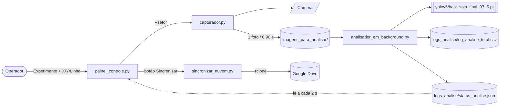

# raimunda — Rover Contador de Plântulas de Soja (FAPA)

Cópia do sistema **v2.0** do rover (marco zero, 2026-08-31, do backup do Google Drive) →
em evolução para **v2.1** (10 PRs). **Estado atual e o que falta:** [`docs/STATUS.md`](docs/STATUS.md).

> O commit `4d7ac16` é a linha de base sem correções ("marco zero"); a lista de bugs
> conhecidos abaixo é daquele ponto — a maioria já foi resolvida (ver [`CHANGELOG.md`](CHANGELOG.md)).

## O que o sistema faz

Rover de campo que percorre a linha de plantio, fotografa o solo e **conta plântulas de
soja** por visão computacional (YOLOv5), gravando um CSV por parcela e enviando backup
para o Google Drive.



## Componentes

| Arquivo | Papel |
|---|---|
| `painel_controle.py` | Shim de compatibilidade — `from ui.painel import App, main` (`refactor/ui-split`). Processo mãe. |
| `ui/painel.py` | A classe `App` (GUI Tkinter "Estação de Controlo de Captura"). |
| `ui/widgets.py` | Construção de cada bloco da tela (Configurações, Controles, Visão Computacional, Telemetria). |
| `ui/tema.py` | Cores e fontes do painel. |
| `capturador.py` | Captura contínua pela câmera (`picamera2`), 1 foto a cada 0,90 s, 1280×720. |
| `analisador_em_background.py` | Vigia a pasta, roda YOLOv5, aplica correção estatística, grava CSV/JSON. |
| `core/status.py` | Schema único do `status_analise.json` (leitura/escrita atômica). |
| `core/parcela.py` | Modelo da parcela (`X3Y7L2`) + navegador da campanha (segue a planilha da semeadora ou incremento aritmético). |
| `core/io_atomico.py` | Escrita atômica dos arquivos de estado (`status`, `parcela`, `setor`). |
| `core/eventos.py` | Log de eventos append-only (`logs_analise/eventos.jsonl`). |
| `core/watchdog.py` | sd_notify opcional (watchdog do systemd); no-op fora do systemd. |
| `core/registro.py` | CSV canônico de análise (colunas *tidy*, uma variável por coluna). |
| `core/export.py` · `exportar_planilha.py` | Preenche as colunas `linha 1/2/3` da planilha da semeadora com a contagem corrigida. |
| `deploy/` | `rover.service` + `install.sh` — sobe no boot e reinicia se cair (ver `deploy/README.md`). |
| `sincronizar_nuvem.py` | `rclone copy` das imagens e do CSV para o remote configurado. |
| `iniciar_aplicacao.sh` | Arranque: ativa o `venv` e roda o painel. |
| `detector_backend.py` | Classe `YoloDetector` usada pelas GUIs de teste. |
| `app_final.py`, `app_gui.py` | GUIs de análise de 1 imagem (fora do fluxo do rover). |
| `testeCAM.py` | Pré-visualização da câmera para ajuste de lente. |
| `converter_mascaras.py`, `coco_para_yolo.py` | Preparo de dataset (máscara/COCO → labels YOLO). |
| `requirements.txt` | Dependências (base YOLOv5 + `ultralytics` + `picamera2`). |

## Como montar o ambiente (Raspberry Pi 5, arm64)

```bash
# 1. clonar o repo
git clone <este-repo> raimunda && cd raimunda

# 2. clonar o YOLOv5 dentro da pasta (o analisador carrega com source='local')
git clone https://github.com/ultralytics/yolov5 yolov5

# 3. colocar os pesos em yolov5/
#    best_soja_final_97_5.pt  (~14 MB) — obter do backup do Drive (Projeto_Soja/yolov5/)

# 4. ambiente virtual (NÃO copiar venv de outra máquina — recriar aqui)
python3 -m venv venv
source venv/bin/activate
pip install -r requirements.txt

# 5. rclone para o backup na nuvem
rclone config          # criar o remote (padrão: "gdrive" — ver config.py)

# 6. rodar
./iniciar_aplicacao.sh
```

## Configuração (`config.py`)

Todos os caminhos, parâmetros do modelo e o destino da nuvem ficam em
[`config.py`](config.py) — ponto único de verdade. Os scripts não têm mais
caminho absoluto nem constante espalhada.

- **Padrão:** tudo é derivado de `BASE_DIR` (a pasta do repositório). Clonou e
  rodou, funciona.
- **Ajuste por máquina:** variáveis de ambiente `ROVER_*` (ex.: `ROVER_BASE_DIR`,
  `ROVER_RCLONE_REMOTE`, `ROVER_MODELO_PATH`, `ROVER_INTERVALO_CAPTURA_S`) **ou**
  copie `config_local.example.py` → `config_local.py` (ignorado pelo git) e
  sobrescreva só o que mudar.
- **Segredos** (`rclone.conf`) ficam no sistema, **nunca** em `config.py`.

Ref.: *The Twelve-Factor App* (fator III); Parnas (1972). Ver
[`docs/MELHORIAS.md`](docs/MELHORIAS.md) frente #1.

## Testes

```bash
pip install -r requirements-dev.txt   # só pytest — não precisa do requirements.txt completo
python -m pytest tests/ -q
```

Não precisa de câmera, GPU, `torch`/`cv2`/`picamera2` nem `rclone` instalados
— os testes usam dublês (`FakeModel`, `subprocess.run`/`Popen` substituídos)
e, quando um módulo pesado já está instalado (no Pi), usam o de verdade sem
diferença de comportamento.

- `test_config.py`, `test_status.py` — contrato de `config.py` e `core/status.py`.
- `test_characterization_*.py` — **testes de caracterização**: travam o
  comportamento atual de `analisador_em_background.py`, `sincronizar_nuvem.py`
  e `painel_controle.py` (GUI real, via Xvfb se não houver `$DISPLAY`) antes
  de qualquer refactor. Se um destes quebrar depois de uma mudança que
  deveria ser "só reorganizar código", é regressão — investigar antes de
  atualizar o teste. Ref.: Feathers, *Working Effectively with Legacy Code*
  (2004).
- `CHECKLIST-CAMPO.md` — o que só dá para caracterizar no Pi com hardware
  real (câmera, modelo, `rclone`).

Ver [`docs/MELHORIAS.md`](docs/MELHORIAS.md) frente #7.

## Parcela / campanha (`core/parcela.py`)

O painel identifica cada setor como **`X{x}Y{y}L{linha}`** (ex.: `X3Y7L2`) —
formato configurável em `config.PARCELA_FORMATO`. O botão **Próxima (F2)** anda
linha 1→2→3 e depois o próximo plot.

- **Modo campanha:** coloque a planilha de programação da semeadora como
  `programacao_semeadora.csv` (ou `.xlsx`) na raiz do projeto. O rover carrega a
  ordem dos plots (colunas `Parcela Larg. (X)` / `Parcela Compr.(Y)`) e o nome do
  experimento (`ID Opcional`); "Próxima" segue a sequência da planilha
  (`plot 47 de 216`). Exemplo em `docs/exemplos/`.
- **Modo manual:** sem planilha, "Próxima" incrementa X/Y nas faixas de
  `config.PARCELA_X_MIN..MAX` / `..Y..`.
- A posição é **persistida** (`logs_analise/parcela_atual.json`) — o painel retoma
  onde parou depois de reiniciar.
- **Trocar de carreira sem parar a câmera:** durante a captura, "Próxima" (F2)
  grava o novo identificador em `logs_analise/setor_atual.txt`; o `capturador.py`
  relê esse arquivo a cada foto. A carreira anterior congela, a nova começa a
  somar. (`◂ Voltar` e editar experimento continuam exigindo parar a captura.)

Aberto com o Leandro: formato exato do identificador (zero à esquerda? separador?),
ordem das 3 linhas. Ver `docs/ANALISE-E-MAPA.md` e a nota `Planilha da semeadora`
no vault.

### Exportar o resultado

No fim da campanha, gera uma cópia da planilha com as colunas
`linha 1 / linha 2 / linha 3` preenchidas com a **contagem corrigida** somada
por linha:

```bash
python exportar_planilha.py --experimento "Antecipado Pinhão 2025"
```

Ou, no painel, **Ctrl+E**. Saída: `export_<data>.xlsx` (preserva as abas da
planilha) — ou `.csv` se a planilha de entrada for `.csv`.

## Bugs conhecidos (não corrigidos neste marco zero)

1. **"TOTAL ACUMULADO" fica sempre em 0.** O `analisador_em_background.py` grava
   `status_analise.json` com a chave `ultima_imagem_analisada`; o `painel_controle.py`
   procura `imagem_atual` / `total_plantulas_linha`. Nunca casa.
   → resolvido em `refactor/status-schema` (`core/status.py`).
2. **O painel mostra a contagem bruta**, não a `plantulas_estimadas_reais` (corrigida
   por precisão 0,934 / recall 0,921). → resolvido em `refactor/status-schema`.
3. **Colunas do CSV divergem entre versões** — o código escreve
   `plantulas_detectadas_ia` / `plantulas_ajustadas`; o CSV de campo tem
   `plantulas_corrigidas` / `plantulas_detectadas`.
   → resolvido em `feat/export-csv`: cabeçalho canônico *tidy* (`core/registro.py`),
   CSV antigo arquivado no primeiro arranque.
4. **Nomenclatura de parcelas inconsistente** — o CSV real tem 11 padrões diferentes de
   `setor_imagem` + 97 linhas vazias. O código gera `trat_{Tratamento}_linha_{Linha}`,
   mas os dados mostram `lote_XX_var_YY` e variações. Ver `docs/ANALISE-E-MAPA.md`.
   → resolvido em `feat/parcela`: identificador estruturado `X{x}Y{y}L{linha}`
   (`core/parcela.py`), navegação por plot. Falta a limpeza/migração do histórico (RV-06).
5. **`sincronizar_nuvem.py` com caminhos absolutos fixos** (`/home/operador/Desktop/...`)
   e remote `gdrive` hard-coded. → resolvido em `refactor/config` (`config.py`).
6. **Telemetria do painel corta texto longo** (layout de largura fixa).
   → resolvido em `feat/ui-v1`.

## No boot / reinício automático

Ver [`deploy/README.md`](deploy/README.md): `rover.service` (systemd de
usuário) sobe o painel no boot, reinicia em 5 s se cair e usa watchdog
(mata + reinicia se travar 120 s). O estado da campanha
(`status_analise.json`, `parcela_atual.json`) é persistido com escrita
atômica — retoma onde parou. `logs_analise/eventos.jsonl` guarda a trilha do
que aconteceu (auditoria).

## Roadmap (backlog de manutenção — RV)

Status detalhado em [`docs/STATUS.md`](docs/STATUS.md).

| ID | Item | Situação |
|---|---|---|
| RV-01 | Eixo móvel na traseira do rover (mecânica) | aberto |
| RV-02 | Botão de troca automática de parcela | **software pronto** · confirmar formato c/ Leandro |
| RV-03 | Case móvel para o display | com o Felipe |
| RV-04 | Sincronização em nuvem na conta do pesquisador | script pronto · falta conta/autorização |
| RV-05 | Pré-configuração de Wi-Fi | aberto (falta SSID/senha) |
| RV-06 | Padronização da nomenclatura + limpeza do histórico | **CSV + export prontos** · confirmar formato c/ Leandro |
| RV-07 | Provisionar o Pi 5 (contas `nero` e `operador`) | `deploy/` pronto · falta rodar no Pi |
| RV-08 | Validação metrológica da contagem (calibração, incerteza) | aberto — **precisa de ida a campo** |

## Créditos

Código original: Gabriel Woitovetch. Projeto no âmbito da FAPA.
