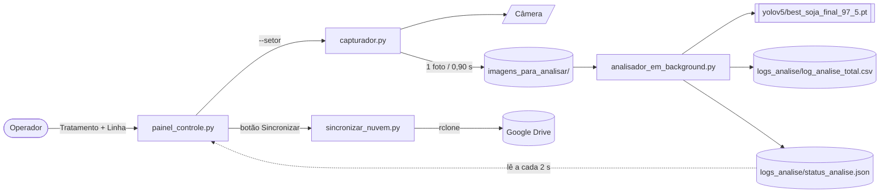

# raimunda — Rover Contador de Plântulas de Soja (FAPA)

**Marco zero.** Este repositório é uma cópia fiel do sistema **v2.0** do rover que roda hoje
no Raspberry Pi da FAPA, tirada em 2026-08-31 a partir do backup do Google Drive.
A partir daqui todas as mudanças ficam versionadas — este commit inicial é a linha de base.

> ⚠️ O código está **como estava**, sem correções. Os bugs conhecidos estão listados
> abaixo e detalhados em [`docs/ANALISE-E-MAPA.md`](docs/ANALISE-E-MAPA.md).

## O que o sistema faz

Rover de campo que percorre a linha de plantio, fotografa o solo e **conta plântulas de
soja** por visão computacional (YOLOv5), gravando um CSV por parcela e enviando backup
para o Google Drive.



## Componentes

| Arquivo | Papel |
|---|---|
| `painel_controle.py` | GUI Tkinter "Estação de Controlo de Captura v2.5". Processo mãe. |
| `capturador.py` | Captura contínua pela câmera (`picamera2`), 1 foto a cada 0,90 s, 1280×720. |
| `analisador_em_background.py` | Vigia a pasta, roda YOLOv5, aplica correção estatística, grava CSV/JSON. |
| `sincronizar_nuvem.py` | `rclone copy` das imagens e do CSV para `gdrive:Rover_FAPA_Backups`. |
| `iniciar_aplicacao.sh` | Arranque: ativa o `venv` e roda o painel. |
| `detector_backend.py` | Classe `YoloDetector` usada pelas GUIs de teste. |
| `app_final.py`, `app_gui.py` | GUIs de análise de 1 imagem (fora do fluxo do rover). |
| `testeCAM.py` | Pré-visualização da câmera para ajuste de lente. |
| `converter_mascaras.py`, `coco_para_yolo.py` | Preparo de dataset (máscara/COCO → labels YOLO). |
| `requirements.txt` | Dependências (base YOLOv5 + `ultralytics` + `picamera2`). |

## Como montar o ambiente (Raspberry Pi 5, arm64)

```bash
# 1. clonar o repo
git clone <este-repo> raimunda && cd raimunda

# 2. clonar o YOLOv5 dentro da pasta (o analisador carrega com source='local')
git clone https://github.com/ultralytics/yolov5 yolov5

# 3. colocar os pesos em yolov5/
#    best_soja_final_97_5.pt  (~14 MB) — obter do backup do Drive (Projeto_Soja/yolov5/)

# 4. ambiente virtual (NÃO copiar venv de outra máquina — recriar aqui)
python3 -m venv venv
source venv/bin/activate
pip install -r requirements.txt

# 5. rclone para o backup na nuvem
rclone config          # criar o remote (padrão: "gdrive" — ver config.py)

# 6. rodar
./iniciar_aplicacao.sh
```

## Configuração (`config.py`)

Todos os caminhos, parâmetros do modelo e o destino da nuvem ficam em
[`config.py`](config.py) — ponto único de verdade. Os scripts não têm mais
caminho absoluto nem constante espalhada.

- **Padrão:** tudo é derivado de `BASE_DIR` (a pasta do repositório). Clonou e
  rodou, funciona.
- **Ajuste por máquina:** variáveis de ambiente `ROVER_*` (ex.: `ROVER_BASE_DIR`,
  `ROVER_RCLONE_REMOTE`, `ROVER_MODELO_PATH`, `ROVER_INTERVALO_CAPTURA_S`) **ou**
  copie `config_local.example.py` → `config_local.py` (ignorado pelo git) e
  sobrescreva só o que mudar.
- **Segredos** (`rclone.conf`) ficam no sistema, **nunca** em `config.py`.

Smoke test: `python -m pytest tests/ -q`

Ref.: *The Twelve-Factor App* (fator III); Parnas (1972). Ver
[`docs/MELHORIAS.md`](docs/MELHORIAS.md) frente #1.

## Bugs conhecidos (não corrigidos neste marco zero)

1. **"TOTAL ACUMULADO" fica sempre em 0.** O `analisador_em_background.py` grava
   `status_analise.json` com a chave `ultima_imagem_analisada`; o `painel_controle.py`
   procura `imagem_atual` / `total_plantulas_linha`. Nunca casa.
   → resolvido em `refactor/status-schema` (`core/status.py`).
2. **O painel mostra a contagem bruta**, não a `plantulas_estimadas_reais` (corrigida
   por precisão 0,934 / recall 0,921). → resolvido em `refactor/status-schema`.
3. **Colunas do CSV divergem entre versões** — o código escreve
   `plantulas_detectadas_ia` / `plantulas_ajustadas`; o CSV de campo tem
   `plantulas_corrigidas` / `plantulas_detectadas`.
4. **Nomenclatura de parcelas inconsistente** — o CSV real tem 11 padrões diferentes de
   `setor_imagem` + 97 linhas vazias. O código gera `trat_{Tratamento}_linha_{Linha}`,
   mas os dados mostram `lote_XX_var_YY` e variações. Ver `docs/ANALISE-E-MAPA.md`.
5. **`sincronizar_nuvem.py` com caminhos absolutos fixos** (`/home/operador/Desktop/...`)
   e remote `gdrive` hard-coded. → resolvido em `refactor/config` (`config.py`).
6. **Telemetria do painel corta texto longo** (layout de largura fixa).

## Roadmap (backlog de manutenção — RV)

| ID | Item |
|---|---|
| RV-01 | Eixo móvel na traseira do rover (mecânica) |
| RV-02 | Botão de troca automática de parcela no teclado |
| RV-03 | Case móvel para o display |
| RV-04 | Sincronização em nuvem apontando para a conta do pesquisador |
| RV-05 | Pré-configuração de Wi-Fi |
| RV-06 | Padronização da nomenclatura de parcelas/linhas + limpeza do histórico |
| RV-07 | Provisionar o Pi 5 (contas `nero` admin e `operador`) |
| RV-08 | Protocolo de validação metrológica da contagem (calibração, incerteza) |

## Créditos

Código original: Gabriel Woitovetch. Projeto no âmbito da FAPA.
