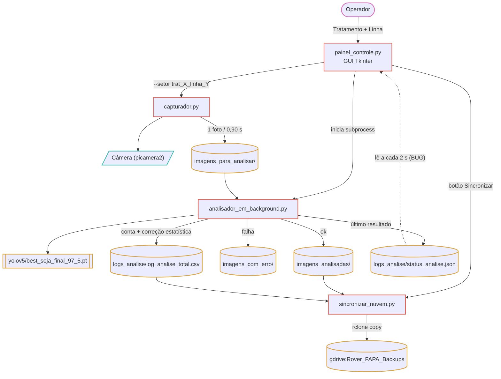
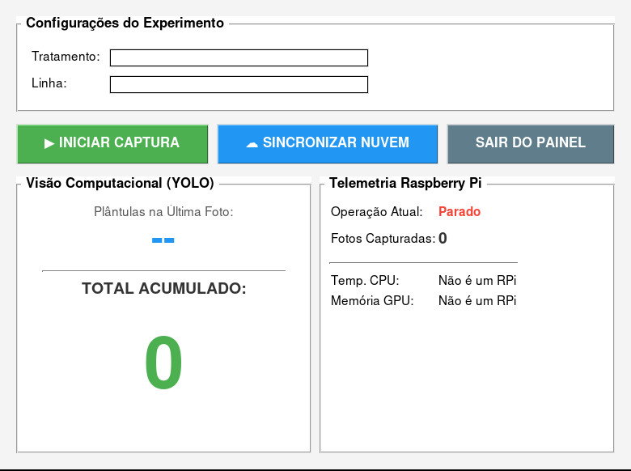
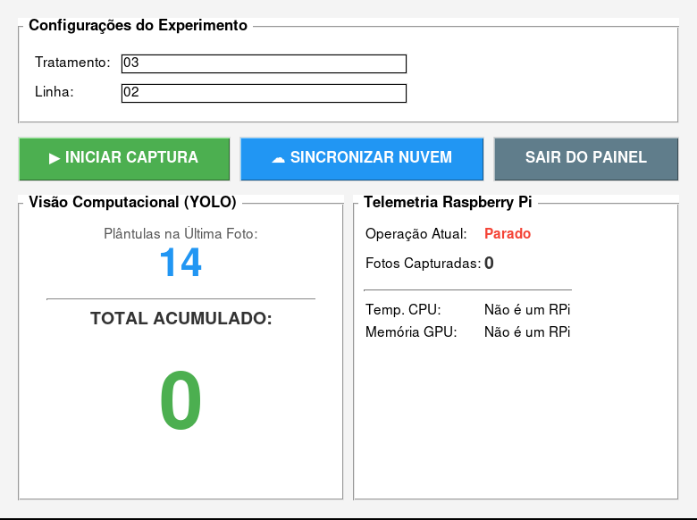
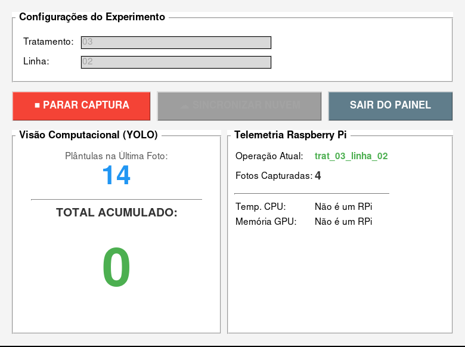

# Análise do sistema v2.0 — Rover Contador de Plântulas

Análise feita em 2026-08-31 a partir do backup do Google Drive (`Projeto_Soja/`).

## Arquitetura — 3 processos + 1 script

## A interface (painel_controle.py)

Screenshots do painel real rodando (parado / com dados / capturando):

| Parado | Com dados no JSON | Capturando |
|---|---|---|
|  |  |  |

- 3 zonas: **Configurações** (Tratamento + Linha) → 3 botões → dashboard `Visão Computacional (YOLO)` \| `Telemetria Raspberry Pi`.
- Máquina de estados OK: ao iniciar a captura os campos travam, o botão vira `■ PARAR CAPTURA` vermelho, o Sincronizar é desabilitado, e a *Operação Atual* mostra `trat_03_linha_02`.
- Confirmado na tela: com `plantulas_detectadas_ia: 14` e `plantulas_estimadas_reais: 15` no JSON, a "Última Foto" mostra **14** (bruto) e o "TOTAL ACUMULADO" fica **0**.

## Modelo YOLO

- Produção: `yolov5/best_soja_final_97_5.pt` (~14 MB, porte YOLOv5s). `conf = 0.70`, `classes = [0]`.
- Correção estatística (`calcular_contagem_ajustada`): `ajustada = ceil( (bruta − bruta·(1−0,934)) / 0,921 )`.
- Carregado com `torch.hub.load('yolov5', 'custom', source='local')` → exige o repo `yolov5/` clonado.
- Outros `.pt` no backup (confusão de versões): `yolov5/best.pt` (54 MB), `Modelo/best.pt` (14 MB), `Modelo/best2.pt` (54 MB).

## Nomenclatura de parcelas — inconsistente

O código gera `setor = trat_{Tratamento}_linha_{Linha}`. O `log_analise_total.csv` de campo
(1006 registros, set/2025 → fev/2026) tem **11 padrões diferentes**, nenhum igual ao gerado:

| `setor_imagem` | registros |
|---|---|
| `lote_02_var_01` | 583 |
| *(vazio)* | 97 |
| `lote_2026-01_var_001` | 78 |
| `lote_2026-01_var_002` | 57 |
| `lote_8528_var_552` | 52 |
| `lote_2026-01_var_003` | 50 |
| `lote_01_var_01` | 39 |
| `lote_00_var_00` | 28 |
| `lote_00_var_01` | 18 |
| `lote_2026_var_03` | 3 |
| `lote_9_var0` | 1 |

Variações: zero à esquerda (`9`/`02`/`002`), separador antes da variedade (`var0`/`var_01`),
formato do lote (`02`/`2026-01`/`8528`), 97 linhas vazias, valores de teste. O rótulo do
campo no painel já foi "Linha" e "Variedade".

## Bugs e inconsistências

1. **`status_analise.json` — contrato de chaves quebrado.**
   Analisador grava `ultima_imagem_analisada`, `plantulas_detectadas_ia`, `plantulas_estimadas_reais`.
   Painel lê `imagem_atual`, `total_plantulas_linha`. → "TOTAL ACUMULADO" nunca soma.
2. **Painel mostra o valor bruto**, não o corrigido.
3. **Colunas do CSV divergem do código** (`plantulas_detectadas_ia`/`plantulas_ajustadas` vs `plantulas_corrigidas`/`plantulas_detectadas`).
4. **97 linhas vazias** no CSV; sem validação.
5. **`sincronizar_nuvem.py`**: caminhos absolutos fixos + remote `gdrive` hard-coded + sem checagem real de rede + sem fila offline.
6. **Reprodutibilidade**: `requirements.txt` quase todo com `>=` (sem pin).
7. **Troca de parcela é manual**: parar captura → editar campos → reiniciar.
8. **Telemetria do painel** corta texto longo (layout de largura fixa).
9. Título diz "v2.5"; este é o pacote "v2.0".
10. Lixo no backup: `*.py.save`, `*.py.save.1`, `__pycache__/`, `venv/` e `.git/` do yolov5 dentro do zip de 1,54 GiB.

## Configuração de nuvem (concreto)

- `rclone`, remote **`gdrive`**.
- `gdrive:Rover_FAPA_Backups/imagens_analisadas` e `.../relatorios`.
- `rclone copy <origem> <destino> --update --progress --transfers=4`.
