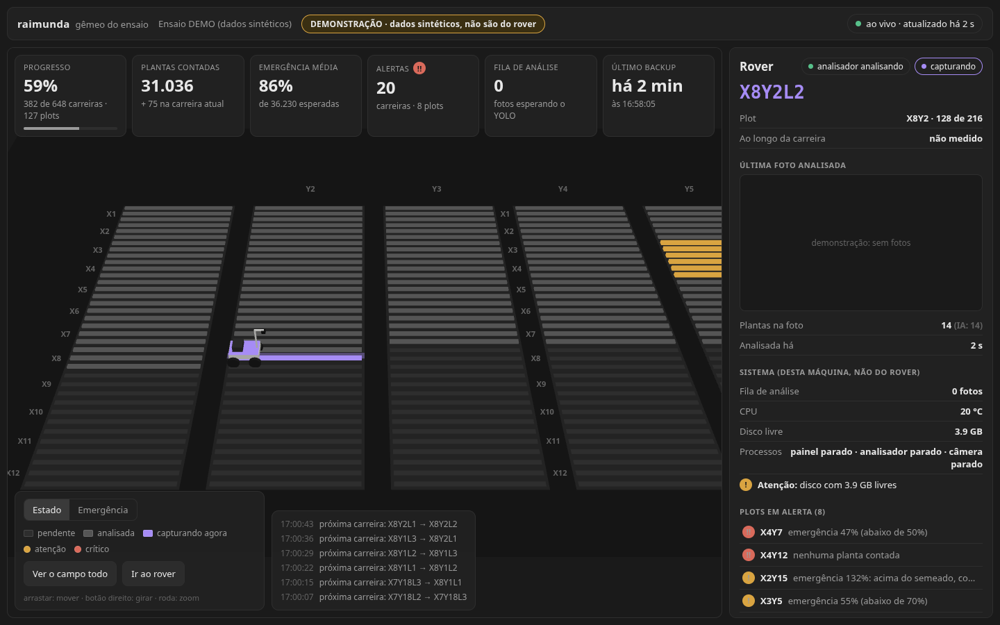
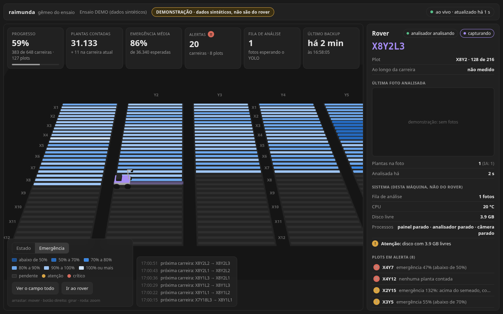

# Gêmeo digital do ensaio (visão 3D)

Uma visão 3D, **só de leitura**, do campo experimental: os plots da planilha
da semeadora, as 3 carreiras de cada um, o rover e a contagem. Ela é
alimentada pelos arquivos que o sistema já grava; o pipeline de captura e
análise não muda.

Inspiração: a demo *WareTrack* de Dilum Sanjaya (React Three Fiber). Daquela
demo vem a ideia central, **modelo de dados primeiro e o 3D como só mais uma
visão**. Do que ela fazia de errado (relógio "ao vivo" acelerado, histórico
recalculado a partir de "agora", painéis que se contradiziam, posição de
objetos que ninguém mede) vêm as regras abaixo.

## Regras

1. **Dados primeiro.** A visão só desenha o que está no snapshot.
2. **Um lugar só calcula indicador:** `core/campo.py`. A visão não soma nada,
   então dois blocos da tela nunca discordam.
3. **Horário vem do arquivo** (CSV, `eventos.jsonl`) e nunca é recalculado.
   "Agora" só entra nas idades (`idade_*_s`).
4. **Só o medido.** Não há odômetro/GPS nem as caixas do YOLO gravadas: não
   existe posição ao longo da carreira nem posição de planta. Se algum dia a
   visão desenhar plantas, elas vêm rotuladas como ilustração.
5. **Cor só em exceção** (frente #6 do `MELHORIAS.md`): neutro por padrão,
   âmbar/vermelho só acima dos limiares escritos em `config.py`.
6. **Só leitura.** A visão não comanda o rover. Operar continua sendo no
   painel Tkinter.

## Arquitetura

```
 Pi 5 (já existe)                        novo
 +-------------------------------+      +---------------------------+
 | capturador > analisador > CSV |      | core/campo.py             |
 | status.json, parcela.json     | ---> | monta o snapshot do       |
 | eventos.jsonl, Plan1, fotos   |      | ensaio (só leitura)       |
 +-------------------------------+      +-------------+-------------+
                                                      | JSON
                        +-----------------------------+--------------+
                        v                                            v
           servidor_visao.py (Pi, rede local)          exportar_gemeo.py
           HTTP só leitura                             HTML único com os dados
                        |                                            |
                        v                                            v
           tablet/notebook no campo                    escritório, estande
              (web/: React + React Three Fiber + drei + zustand)
```

## O snapshot (`core/campo.py`, schema 1)

```bash
python -m core.campo                      # JSON indentado do experimento atual
python -m core.campo --experimento "Safra 2024" --compacto --sem-telemetria
```

| Chave | O que é |
|---|---|
| `schema`, `gerado_em`, `versao_software` | versão do formato, relógio do Pi, versão do código |
| `demo` | `true` se existir o arquivo `DEMO` ao lado do CSV (dados de demonstração) |
| `experimento`, `experimentos`, `campanha_atual` | o mostrado, todos os conhecidos, e se é a campanha do painel |
| `fontes` | de onde veio: planilha usada, linhas do CSV, linhas sem parcela (nome antigo), fora da grade |
| `campo` | geometria em metros (`u` transversal às carreiras, `v` ao longo) e a lista `plots` |
| `campo.plots[].carreiras[]` | por carreira: estado, contagem, esperado, emergência, nº de fotos, horários, sync/export, versões, alerta |
| `rover` | posição (só na campanha atual e se o painel já gravou), captura ligada, analisador, fila, última foto, alertas |
| `kpis` | totais calculados uma vez só (batem com a soma dos plots) |
| `saude` | telemetria do Pi (temperatura, disco, processos vivos) e alertas de disco/backup |
| `limiares`, `nota_contagem` | os limiares em vigor e o aviso sobre o que a contagem significa |
| `eventos` | os últimos `CAMPO_EVENTOS_LIMITE` eventos (linha do tempo) |

### Definições

- **Esperado (carreira)** = `Grãos por Parcela` ÷ carreiras por plot.
- **Emergência** = plantas contadas (corrigido) ÷ esperado. Só existe quando a
  planilha traz os grãos.
- **Plantas (KPI)** = soma das carreiras **fechadas** (`analisada`). A carreira
  em captura é parcial e aparece à parte em `plantulas_em_captura`; ela também
  não dispara alerta enquanto está sendo capturada.
- **Capturando** = o último evento entre `captura_iniciada`, `captura_parada` e
  `painel_iniciado` é `captura_iniciada`.
- **Linhagem da carreira** = capturada (primeira/última foto) → analisada →
  sincronizada (primeiro `sync_ok` depois da última análise) → exportada
  (primeiro `planilha_exportada` depois da última análise).

### Limiares (provisórios: fechar com o Leandro)

| `config.py` | Padrão | Dispara |
|---|---|---|
| `CAMPO_EMERGENCIA_CRITICO` | 0.50 | crítico abaixo disto (e contagem zero) |
| `CAMPO_EMERGENCIA_ATENCAO` | 0.70 | atenção abaixo disto |
| `CAMPO_EMERGENCIA_MAXIMA` | 1.20 | atenção acima disto (dupla contagem? planilha errada?) |
| `CAMPO_FILA_ATENCAO` | 20 | fotos esperando análise |
| `CAMPO_STATUS_VELHO_S` | 30 | captura ligada e o analisador sem gravar status |
| `CAMPO_SYNC_VELHA_S` | 7200 | último backup na nuvem |
| `CAMPO_DISCO_ATENCAO_GB` / `_CRITICO_GB` | 5 / 1 | disco livre |

### Geometria

Vem da Plan1 (`Comprimento Parcela (cm)`, `Passagem (cm)`, `Espaçam. fil
(cm)`, `Carreiras por parcela`) ou, sem planilha, de `CAMPO_*_CM`. Padrão: X
anda transversal às carreiras e Y ao longo delas, como dizem os nomes das
colunas. **Ainda em aberto com o Leandro** (as abas Plan1 e Planilha1
divergem): `ROVER_CAMPO_TROCAR_EIXOS=1` inverte. O próprio mapa 3D serve para
validar com ele.

### Desempenho

O CSV e o `eventos.jsonl` só crescem. `campo.Cache` lê apenas as linhas novas
desde a última chamada (e relê a planilha só quando ela muda). Medido numa
campanha inteira (216 plots, ~9,7 mil fotos): ~100 ms sem cache, ~13 ms com
cache. JSON compacto ~330 KB, ~18 KB com gzip.

## O servidor (`servidor_visao.py`)

```bash
python servidor_visao.py                 # 0.0.0.0:8080; mostra os endereços
python servidor_visao.py --host 127.0.0.1 --porta 8765 --sem-telemetria
```

| Rota | Resposta |
|---|---|
| `GET /api/snapshot[?experimento=NOME]` | o snapshot (gzip se o cliente aceitar; `no-store`) |
| `GET /api/foto/<nome>.jpg` | foto de `imagens_analisadas/` (nome validado; nada fora da pasta) |
| `GET /`, `/assets/...` | a visão compilada (`web/dist`); sem build, uma página explicando |
| qualquer outro método | `405` (só `GET`/`HEAD`) |

Um snapshot por `VISAO_CACHE_S` (1 s) para todos os clientes juntos. Medido
com a campanha inteira: primeira resposta ~130 ms, depois <1 ms, ~19 KB com
gzip. Não escreve nada em disco (há teste para isso). No Pi:
`./deploy/install.sh --visao` (ver `deploy/README.md`).

## A tela (`web/`)




*(capturas da campanha sintética de demonstração, não de dados reais)*

- **Cena:** o campo em escala real, a partir da planilha. Carreira com dado
  fica mais alta, e com alerta mais alta ainda. Plot em alerta ganha um pino 3D,
  para o alerta nunca depender só de cor. O rover fica no começo da carreira
  em que o painel diz que ele está, porque a posição ao longo dela não é medida;
  a carreira inteira acende, e pulsa enquanto captura.
- **Dois modos de cor:** *Estado* (neutro; roxo = capturando; âmbar/vermelho =
  alerta) e *Emergência* (rampa azul de 6 faixas, cortes de alerta vindos de
  `config.py`). Cores validadas para daltonismo e contraste contra o fundo.
- **Câmera:** abre numa vista de trabalho oblíqua em volta do rover; "ver o
  campo todo" olha mais de cima (o ensaio é uma tira de 125 x 18 m). Chegar
  dado novo nunca mexe na câmera.
- **Painel lateral:** rover (posição, última foto, sistema, alertas), plot
  (tabela das 3 carreiras) ou carreira (linhagem com horários gravados).
  A lista de plots em alerta é a "tabela" acessível do mapa.
- **Honestidade:** selo "ao vivo" só com resposta recente; "sem conexão" mostra
  há quanto tempo; DEMONSTRAÇÃO sempre visível com dado sintético; a nota sobre
  o que a contagem significa fica no rodapé do painel.

Como rodar: `web/README.md`. Demonstração completa sem o rover:
`./ferramentas/rodar_demo.sh` (campanha sintética ao vivo + servidor).

## Limitações conhecidas

- **Contagem = soma das fotos.** Fotos sobrepostas podem contar a mesma planta
  duas vezes; a correção P/R é fixa. É o RV-08 (calibração de campo) que dá
  base ao número absoluto. O limiar de emergência máxima existe para expor
  isso.
- **Relógio do Pi.** As idades são calculadas com o relógio do próprio Pi, então
  são coerentes entre si. Já os horários absolutos dependem de o Pi estar com a
  hora certa (sem rede e sem bateria no RTC, ele pode voltar no tempo após um
  boot).
- **Leitura incremental** não suporta quebra de linha dentro de um campo do CSV
  (o painel não gera isso).
- **Servidor sem senha** nesta versão: qualquer aparelho na mesma rede vê
  contagens e fotos. Para restringir: `ROVER_VISAO_HOST=127.0.0.1`.

## Roadmap

| PR | Entrega | Situação |
|---|---|---|
| `feat/campo-snapshot` | `core/campo.py` + testes + CLI | feito |
| `feat/servidor-visao` | servidor HTTP só leitura + `deploy/visao.service` | feito |
| `feat/web-gemeo-v0` | cena 3D: grade, rover, clique → painel; modo DEMO | feito |
| `feat/web-gemeo-vida` | cena viva: rover estimado, plântulas, efeitos, dia/noite, entorno da FAPA | feito |
| `feat/web-gemeo-v1` | replay, tira de fotos | a fazer |
| `feat/exportar-gemeo` | HTML autossuficiente (escritório, estande) | a fazer |
| depois | caixas do YOLO em arquivo à parte, incerteza do RV-08, encoder na roda | conforme o campo |
