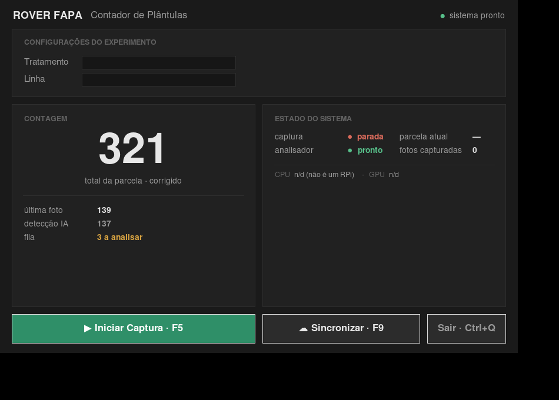
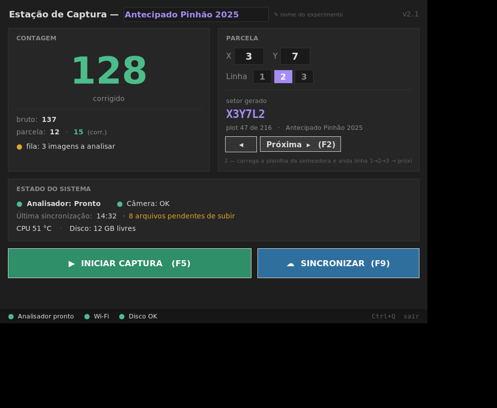

# Plano — Redesign do painel (v1)

Plano de estruturação e primeira iteração do `painel_controle.py`.
Base: [ANALISE-E-MAPA.md](ANALISE-E-MAPA.md). Data: 2026-08-31.
Contexto e embasamento das 8 frentes de melhoria: [MELHORIAS.md](MELHORIAS.md).

## Decisões travadas

| Tema | Decisão |
|---|---|
| Framework | **Tkinter + `ttk`** — sem migração. Python puro, leve no Pi 5. |
| Input no campo | **Teclado físico + touchscreen** — projetar para os dois (atalhos + alvos grandes). |
| Escopo da v1 | Camada 0 (módulos) + bugs de dados + layout novo dos 3 blocos + barra de status. **Sem** o bloco Parcela (depende do RV-06). |

## Camada 0 — estrutura de módulos

Objetivo: `painel_controle.py` hoje mistura layout + orquestração + telemetria + IPC. Separar antes de mexer no visual.

```
raimunda/
├── config.py                    # NOVO — todos os caminhos e constantes
├── config.example.py            # NOVO — template versionado (sem segredos)
├── core/
│   ├── status.py                # NOVO — schema único do status_analise.json + I/O
│   ├── orquestrador.py          # NOVO — start/stop dos subprocessos, contadores, fila
│   └── telemetria.py            # NOVO — CPU/disco/memória, com fallback fora do Pi
├── ui/
│   ├── painel.py                # a tela (ex-painel_controle.py)
│   ├── tema.py                  # NOVO — cores, fontes, ttk.Style
│   └── widgets.py               # NOVO — blocos reutilizáveis (Cartao, NumeroGrande…)
├── painel_controle.py           # vira shim: `from ui.painel import main; main()`
├── analisador_em_background.py   # passa a usar core.status e core.telemetria
├── sincronizar_nuvem.py         # passa a ler caminhos de config.py
└── capturador.py                # inalterado
```

### `config.py` — o que sai de hard-coded

| Hoje | Vira |
|---|---|
| `os.getcwd()` como base | `BASE_DIR` explícito |
| `/home/operador/Desktop/Projeto_Soja/...` (em `sincronizar_nuvem.py`) | derivado de `BASE_DIR` |
| `yolov5/best_soja_final_97_5.pt` | `MODELO_PATH` |
| `gdrive:Rover_FAPA_Backups` | `RCLONE_REMOTE`, `NUVEM_BASE` |
| `INTERVALO_SEGUNDOS = 0.90`, `CONFIANCA_IA = 0.70`, `TAXA_PRECISAO/RECALL` | constantes nomeadas em um lugar só |

### `core/status.py` — o schema único (corrige o bug do TOTAL)

Um formato só para o `status_analise.json`. O analisador escreve por aqui, o painel lê por aqui.

```python
@dataclass
class StatusAnalise:
    schema: int = 1
    parcela: str = ""
    ultima_imagem: str = ""
    plantulas_bruto: int = 0          # o que a IA detectou na última foto
    plantulas_corrigido: int = 0      # após correção estatística
    total_parcela_bruto: int = 0      # acumulado da parcela atual
    total_parcela_corrigido: int = 0
    fila_pendente: int = 0            # imagens ainda não analisadas
    analisador_estado: str = "parado" # parado|carregando|pronto|analisando|erro
    timestamp: str = ""
```

- **O analisador mantém o acumulado** (ele é quem sabe a contagem real) e grava tudo.
- **O painel só lê e exibe** — sem lógica de somar (era aí que quebrava: procurava `imagem_atual` / `total_plantulas_linha`, que nunca existiam).
- Campo `schema` para detectar versão incompatível.

## Camada 1 — layout novo

### Implementado (`feat/ui-v1` + `feat/parcela`)



> A tela real, em modo campanha (planilha `Plan1` carregada). `feat/ui-v1`:
> tema por tokens, faixas, pílula de status, fila visível, estado real do
> analisador, atalhos. `feat/parcela`: faixa Experimento (+ editar) / Parcela
> (X/Y/Linha, identificador `X3Y8L2`, `plot 47 de 216`, ◂ / Próxima ▸ F2),
> card "Progresso da parcela" (linha 1/2/3 + total do plot), última sync +
> disco livre. Dados de exemplo via `status_analise.json`.

### Mock original (Tkinter, tema escuro)



> Mock estático só do layout — dados de exemplo. Gerado com `Xvfb` a partir de `mocks/mock_v1.py`.

### Wireframe

```
┌───────────────────────────────────────────────────┐
│  Estação de Captura — [ Antecipado Pinhão 2025 ] ✎ │  ← nome do experimento editável
├─────────────────────────┬─────────────────────────┤
│  CONTAGEM               │  EXPERIMENTO            │
│                         │  X [ 3 ]  Y [ 7 ]       │
│        128              │  Linha  ( 1 )(•2•)( 3 ) │
│      corrigido          │                         │
│   bruto: 137            │  setor gerado:          │
│   parcela: 12 · 15      │  X3Y7L2                 │
│   fila: 3 a analisar ⚠  │  plot 47 de 216         │
│                         │  [ ◂ ] [ Próxima ▸ (F2) ]│  ← Camada 2 (RV-02)
├─────────────────────────┴─────────────────────────┤
│  ESTADO DO SISTEMA                                 │
│  Analisador ● Pronto        Câmera ● OK            │
│  Última sync 14:32 · 8 arquivos pendentes          │
│  CPU 51 °C · Disco 12 GB livres                    │
├───────────────────────────────────────────────────┤
│   [ ▶  INICIAR CAPTURA  (F5) ]  [ ☁ SINCRONIZAR (F9) ] │
├───────────────────────────────────────────────────┤
│  ● Analisador pronto   ● Wi-Fi   ● Disco OK    v2.1│
└───────────────────────────────────────────────────┘
```

### 3 blocos

1. **Contagem** (era "Visão Computacional YOLO")
   - Número grande = contagem **corrigida** (`plantulas_corrigido`), não a bruta.
   - Linha fina: `bruto: X`.
   - `parcela: <bruto> · <corrigido>` — **TOTAL funcionando** (vem pronto do status.json).
   - `fila: N a analisar` — `len(imagens_para_analisar/)`. Se N alto → cor âmbar.

2. **Experimento** (era "Configurações do Experimento") — **redefinido pelo feedback do Leandro (planilha da semeadora, 2026-08-31):**
   - **Nome do experimento** — campo **editável** (pedido explícito do Leandro: o título "Estação de Captura Rover FAPA" deve virar um campo personalizável, exportado como nome do experimento). Ex.: `Antecipado Pinhão 2025`.
   - **X** (largura, 1…12) · **Y** (comprimento, 1…18) · **Linha** (1 / 2 / 3).
   - Mostra o **`setor` gerado** ao vivo: `X3Y7L2`.
   - Base do RV-02 (Camada 2): botão "Próxima" que anda linha 1→2→3 e depois o próximo plot, seguindo a ordem da planilha `Plan1` carregada. Ver `docs/exemplos/` e a nota [[Planilha da semeadora]] do vault.
   - **Aberto com o Leandro**: formato exato (`X3Y7L2` vs `X3Y7-L2` vs zero à esquerda), ordem das linhas, se carrega a planilha.

3. **Estado do sistema** (era "Telemetria Raspberry Pi")
   - **Estado real do analisador**: `Carregando modelo… → Pronto → Analisando → Erro` (hoje só "Parado").
   - Câmera OK / falha.
   - Última sincronização (hora) + nº de arquivos pendentes de subir.
   - CPU / disco livre — **layout que não corta o texto** (o bug atual).

4. **Barra de status** (rodapé, nova) — analisador · rede · disco · versão. Sempre visível.

### Teclado + touch

- Botões com altura ≥ 44 px (touch), rótulo com o atalho: `▶ INICIAR CAPTURA (F5)`.
- Atalhos: **F5** iniciar/parar · **F9** sincronizar · **Ctrl+Q** sair. (a tecla de "próxima parcela" fica **reservada** para o RV-02).
- `:focus` visível (retângulo) para navegação por Tab.

### Sistema visual (`ui/tema.py`)

Ver o mock em `docs/screenshots/mock-painel-v1.png`.

| Token | Valor | Uso |
|---|---|---|
| `BG` / `BG2` / `LINE` | `#1a1a1a` / `#212121` / `#2e2e2e` | fundo · cartão · hairline |
| `T1` / `T2` / `T3` | `#e7e7e7` / `#9a9a9a` / `#626262` | texto primário · secundário · labels |
| `ACC` | `#a68cf5` | **só** o identificador da parcela e links |
| `OK` / `WARN` / `STOP` | `#57c08a` / `#d9a441` / `#d96a5b` | **só** dots e valores de status |

- **Escala de espaço:** 8 / 12 / 20. **Tipo:** display 58 pt · label de seção 8 pt caps · valor 10–13 pt · identificador mono 22 pt.
- Pares **chave → valor** sempre alinhados (coluna de rótulo com largura fixa).
- Cartões com hairline de 1 px, sem sombra.
- Janela redimensionável, mínimo ~820×580.
- Layout em **faixas**: identidade da amostra (Experimento / Parcela) → 2 cartões (Contagem \| Progresso da parcela) → Estado do sistema → ações.

## Bugs de dados corrigidos na v1

| # | Bug | Correção |
|---|---|---|
| 1 | TOTAL ACUMULADO travado em 0 | schema único (`core/status.py`); acumulado calculado no analisador |
| 2 | Painel mostra o valor bruto | número principal passa a ser `plantulas_corrigido` |
| 3 | Sem indicador de fila | `fila_pendente` no status + linha no painel |
| 4 | "Parado" sempre | `analisador_estado` real reportado pelo analisador |
| 5 | Telemetria corta texto | layout do bloco Estado do Sistema refeito |
| 6 | Versão errada no título ("v2.5") | `config.VERSAO` |

**CSV**: com a planilha do Leandro, o cabeçalho canônico passa a separar os campos do plot
(`experimento, X, Y, linha, timestamp_analise, timestamp_imagem, plantulas_bruto, plantulas_corrigido, nome_imagem`)
— assim o **export** pivota direto para as colunas `linha 1 / linha 2 / linha 3` da planilha.
O histórico antigo (11 padrões, 97 linhas vazias) era teste → provável **descartar** e começar limpo. Detalhes em [[Planilha da semeadora]] / RV-06.

## Fora de escopo da v1 (Camada 2+)

- Bloco **Parcela** + botão de troca automática → **RV-02** (depende do **RV-06**)
- Sincronização automática / agendada
- Gráfico de progresso ao longo da linha
- ~~Modo kiosk / autostart no boot~~ → **RV-07** ✅ `deploy/rover.service`
- Migração e limpeza do `log_analise_total.csv` → **RV-06**

## Ordem de implementação (PRs pequenos)

| PR | Entrega | Muda comportamento? | Status |
|---|---|---|---|
| `refactor/config` | `config.py`, tira hard-coded de todos os scripts | não | ✅ `3405ad9` |
| `refactor/status-schema` | `core/status.py`; analisador + painel usam. **Corrige o TOTAL.** | sim (bug fix) | ✅ `24e28b0` |
| (caracterização) | golden master antes do split — `tests/test_characterization_*` | não | ✅ `d769a5c` |
| `refactor/ui-split` | quebra `painel_controle.py` em `ui/` | não (visual igual) | ✅ `151395c` |
| `feat/ui-v1` | `tema.py` + faixas + pílula de status + atalhos | sim (visual) | ✅ |
| `feat/estado-analisador` | analisador reporta estado; painel exibe | sim | ✅ absorvido no `status-schema` + `ui-v1` |
| `feat/parcela` | faixa Parcela: carrega `Plan1`, X/Y/Linha, "Próxima", Progresso do plot | sim | ✅ `core/parcela.py`, schema 2 |

Cada PR é testável rodando o painel headless (`Xvfb` + screenshot), como já foi feito na análise.

## Riscos

- **Mexer no analisador (schema) e quebrar a gravação do CSV em produção** → rodar lado a lado com a versão atual antes de trocar; testes do `core/status.py`.
- **Layout ruim no display real** (tamanho ainda desconhecido — RV-03) → janela redimensionável; validar quando o Felipe entregar o case.
